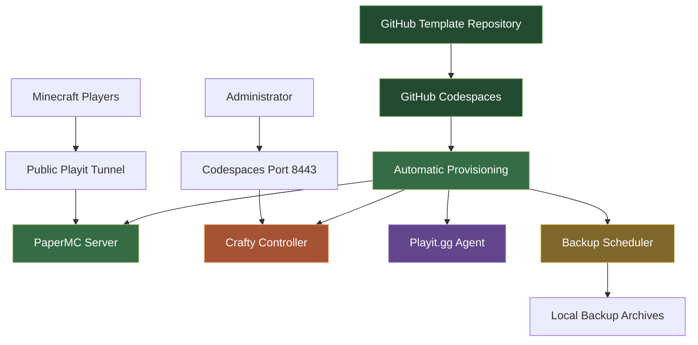

 <div align="center">


<br>

[](https://www.minecraft.net/)
[](https://openjdk.org/)
[](https://papermc.io/)
[](https://github.com/features/codespaces)
[](https://craftycontrol.com/)
[](https://playit.gg/)

[](https://github.com/RufusTheDwarf/mc-server-template/stargazers)
[](https://github.com/RufusTheDwarf/mc-server-template/forks)
[](https://github.com/RufusTheDwarf/mc-server-template/issues)
[](https://github.com/RufusTheDwarf/mc-server-template/commits/main)
[](LICENSE)

<br>

[**Use this template**](https://github.com/RufusTheDwarf/mc-server-template/generate) · [**Installation guide**](Docs/EN.TEMPLATE_GUIDE.md) · [**Issues**](https://github.com/RufusTheDwarf/mc-server-template/issues)

</div>

---

<div align="center">


**Build the environment. Start the server. Invite your friends.**

</div>

## About the project

This repository is a reusable GitHub template that provisions a Minecraft Java server inside a GitHub Codespace.

It brings together the server software, administration panel and public connection tunnel in one cloud environment. The setup script handles most of the installation automatically.

No manual Java installation or local Linux server configuration is required.

### What's included

<div align="center">

| Component | Role |
|:---:|---|
| **PaperMC 1.21.4** | Minecraft Java server |
| **Java 21** | Server runtime |
| **Crafty Controller** | Web-based administration panel |
| **Playit.gg** | Public Minecraft connection tunnel |
| **Python 3.11** | Crafty Controller dependency |
| **GitHub Codespaces** | Cloud Linux environment |
| **Backup scripts** | Scheduled world archives |

</div>

## Visual overview

<div align="center">


</div>

The environment follows this architecture:



**Connection flow:** players connect through Playit.gg, which forwards traffic to the PaperMC server running inside the Codespace.

**Administration flow:** the administrator accesses Crafty Controller through the forwarded Codespaces port.

## Getting started

### 1. Create your own repository

Click the button below:

[](https://github.com/RufusTheDwarf/mc-server-template/generate)

Select **Create a new repository**, choose a name and create it.

### 2. Create a Codespace

In your new repository:

1. Open the **Code** menu.
2. Select the **Codespaces** tab.
3. Click **Create codespace on main**.

The `.devcontainer` configuration automatically launches the provisioning process.

### 3. Automatic installation

The main installation script is:

```bash
.devcontainer/setup.sh
```

It performs the following operations:

- Installs system utilities.
- Installs PaperMC 1.21.4.
- Accepts the Minecraft EULA automatically.
- Creates the Minecraft server directory.
- Generates the server startup and maintenance scripts.
- Schedules hourly backups.
- Installs Crafty Controller and its Python dependencies.
- Installs the Playit.gg agent.
- Starts the Minecraft server and Crafty Controller.

The first provisioning takes several minutes because it downloads the required software.

<details>
<summary><strong>What gets installed?</strong></summary>

```text
~/minecraft-server/
├── server.jar
├── eula.txt
└── server.properties

~/minecraft-server-backups/

~/start.sh
~/keep-alive.sh
~/backup.sh

/var/opt/minecraft/crafty/
└── crafty-4/
    ├── .venv/
    └── app/
        └── config/
```

</details>

### 4. Authenticate Playit.gg

Playit.gg is installed automatically, but its agent must be linked to your account.

Run:

```bash
playit
```

Open the authentication URL displayed in the terminal, sign in and claim the agent.

Then create a **Minecraft Java tunnel** in your Playit.gg dashboard.

Use the local server endpoint:

```text
127.0.0.1:25565
```

Keep the agent running. To launch it in the background, stop the foreground process with `Ctrl+C` and run:

```bash
playit &
```

Do not launch multiple agents simultaneously.

### 5. Connect to your server

Open your [Playit.gg dashboard](https://playit.gg/account/), find the public address assigned to your tunnel and share it with your friends.

In Minecraft Java Edition:

```text
Multiplayer
    |
    +-- Add Server
            |
            +-- Enter your Playit address
```

<badge color="success">Ready to play</badge>

## Crafty Controller

<div align="center">


**Manage your Minecraft server from a web interface.**

</div>

Crafty Controller is installed in the Codespace and exposed through port `8443`.

### Access the dashboard

1. Open the **Ports** tab in your Codespace.
2. Locate port `8443`.
3. Open the forwarded HTTPS address.
4. Sign in using the credentials configured for Crafty.

The initial HTTPS certificate may be self-signed, which can cause a browser security warning.

[Crafty Controller documentation](https://docs.craftycontrol.com/)

### Security configuration

The current Codespaces configuration exposes port `8443` with public visibility.

For a private administration panel, change the port visibility in `.devcontainer/devcontainer.json` to `private`.

**Important:** `config/default.json` contains a fixed initial administrator password in the repository. It must be replaced with a unique secret. Since the repository is public, treat the existing value as compromised. Change the credentials in Crafty after the first login as well.

## Server management

### Start the Minecraft server

The provisioning script creates:

```bash
~/start.sh
```

This generated script launches PaperMC with a 2 GB Java heap and G1 garbage collector optimisations.

After restarting a Codespace, start the server with:

```bash
~/start.sh &
```

The initial provisioning already starts the server. Do not run this command again while it is running.

### Start Crafty Controller

Crafty also needs to be restarted after a stopped Codespace:

```bash
sudo -u crafty bash -c \
'source /var/opt/minecraft/crafty/crafty-4/.venv/bin/activate && cd /var/opt/minecraft/crafty/crafty-4 && python3 main.py' &
```

### Start Playit.gg

```bash
playit &
```

The agent must already be claimed and configured in your Playit.gg account.

### Keep-alive script

The template includes:

```bash
~/keep-alive.sh
```

It writes a timestamp to `keep-alive.log` every ten minutes.

This is a lightweight logging process. It does **not** disable Codespaces inactivity shutdown or guarantee permanent hosting.

## Backup system

<div align="center">


**Automatic hourly world backups**

</div>

The backup script is:

```bash
scripts/backup.sh
```

It creates compressed archives containing the available world directories:

```text
world/
world_nether/
world_the_end/
```

The backup directory is:

```text
~/minecraft-server-backups/
```

Example archive:

```text
world-20261107-140000.tar.gz
```

Cron schedules the backup every hour:

```cron
0 * * * * /home/codespace/backup.sh
```

The current implementation does not automatically delete old archives. Backups remain inside the Codespace and are not an external storage solution.

**Export important world archives before deleting the Codespace.**

## Configuration

### Current server configuration

The template is currently configured around these values:

| Setting | Value |
|---|---|
| Minecraft version | 1.21.4 |
| Server software | PaperMC |
| Java runtime | 21 |
| Initial Java heap | 2 GB |
| Local Minecraft port | 25565 |
| Crafty Controller port | 8443 |
| Backup interval | 1 hour |
| Maximum players in helper configuration | 20 |

PaperMC is downloaded from the Paper API using the latest available build for the pinned Minecraft version.

### Optional configuration script

The repository includes:

```bash
scripts/setup-config.sh
```

It interactively generates `server.properties` and lets the user select:

- Server name / MOTD
- Peaceful, Easy, Normal or Hard difficulty

It currently writes `online-mode=false`.

**Do not use that setting on a public server unless you deliberately intend to run offline mode.** Offline mode does not provide normal Minecraft account authentication and allows username impersonation.

There is an implementation distinction: the setup script generates its own `~/start.sh`, which does not call `scripts/setup-config.sh`. The configuration helper is only invoked by the repository's `scripts/start.sh` when `server.properties` is missing.

### Minecraft EULA

The provisioning script creates:

```text
~/minecraft-server/eula.txt
```

with:

```properties
eula=true
```

Review the [Minecraft EULA](https://www.minecraft.net/eula) before running the server.

## Codespaces limitations

This template is intended for temporary cloud hosting and experimentation. It is not a permanent 24/7 hosting service.

GitHub Codespaces has usage quotas and automatic shutdown behaviour.

| Resource | GitHub Free personal account |
|---|---:|
| Included compute | 120 core-hours / month |
| Included storage | 15 GB-month |

A two-core machine consumes two core-hours per hour. That means 120 included core-hours provide approximately 60 hours on a two-core machine.

Codespaces normally stops after 30 minutes of inactivity by default. Users can change the timeout setting, but an individual Codespace has a maximum lifetime of 12 hours.

Sources: [GitHub Codespaces billing](https://docs.github.com/en/billing/concepts/product-billing/github-codespaces) · [Codespaces timeout settings](https://docs.github.com/en/codespaces/setting-your-user-preferences/setting-your-timeout-period-for-github-codespaces)

### World persistence

Stopping a Codespace preserves its files, but running processes stop.

Deleting the Codespace removes its local data. This includes:

- Minecraft world files
- Local backup archives
- Server logs
- Local Crafty data

Keep external copies of anything important.

## Repository structure

```text
mc-server-template/
│
├── .devcontainer/
│   ├── devcontainer.json
│   └── setup.sh
│
├── Docs/
│   ├── BR.TEMPLATE_GUIDE.md
│   ├── DE.TEMPLATE_GUIDE.md
│   ├── EN.TEMPLATE_GUIDE.md
│   ├── ES.TEMPLATE_GUIDE.md
│   ├── IT.TEMPLATE_GUIDE.md
│   ├── JA.TEMPLATE_GUIDE.md
│   └── RU.TEMPLATE_GUIDE.md
│
├── config/
│   └── default.json
│
├── scripts/
│   ├── backup.sh
│   ├── keep-alive.sh
│   ├── setup-config.sh
│   └── start.sh
│
├── Others README ᓚᘏᗢ.../
│   ├── BR.README.md
│   ├── DE.README.md
│   ├── ES.README.md
│   ├── IT.README.md
│   ├── JA.README.md
│   └── RU.README.md
│
├── LICENSE
└── README.md
```

## Documentation

Installation guides are available in several languages.

<div align="center">

[](Docs/EN.TEMPLATE_GUIDE.md)
[](Docs/BR.TEMPLATE_GUIDE.md)
[](Docs/DE.TEMPLATE_GUIDE.md)
[](Docs/ES.TEMPLATE_GUIDE.md)
[](Docs/IT.TEMPLATE_GUIDE.md)
[](Docs/JA.TEMPLATE_GUIDE.md)
[](Docs/RU.TEMPLATE_GUIDE.md)

</div>

## Contributing

Contributions, suggestions and bug reports are welcome.

1. Fork the repository.
2. Create a branch.
3. Make your changes.
4. Push the branch.
5. Open a Pull Request.

Example:

```bash
git checkout -b feature/my-feature
git add .
git commit -m "Improve server template"
git push origin feature/my-feature
```

## License

This project is distributed under the **MIT License**.

See [LICENSE](LICENSE) for details.

PaperMC, Crafty Controller, Playit.gg and GitHub Codespaces remain subject to their respective licenses and terms of service.

---

<div align="center">


### Made for the Minecraft community

[](https://github.com/RufusTheDwarf)
[](https://github.com/RufusTheDwarf/mc-server-template)
[](LICENSE)

<br>

[](https://github.com/RufusTheDwarf/mc-server-template/stargazers)
[](https://github.com/RufusTheDwarf/mc-server-template/issues)
[](https://github.com/RufusTheDwarf/mc-server-template/fork)

<br>

<sub>Designed and maintained by **RufusTheDwarf** · MIT License · © 2026</sub>


</div>
